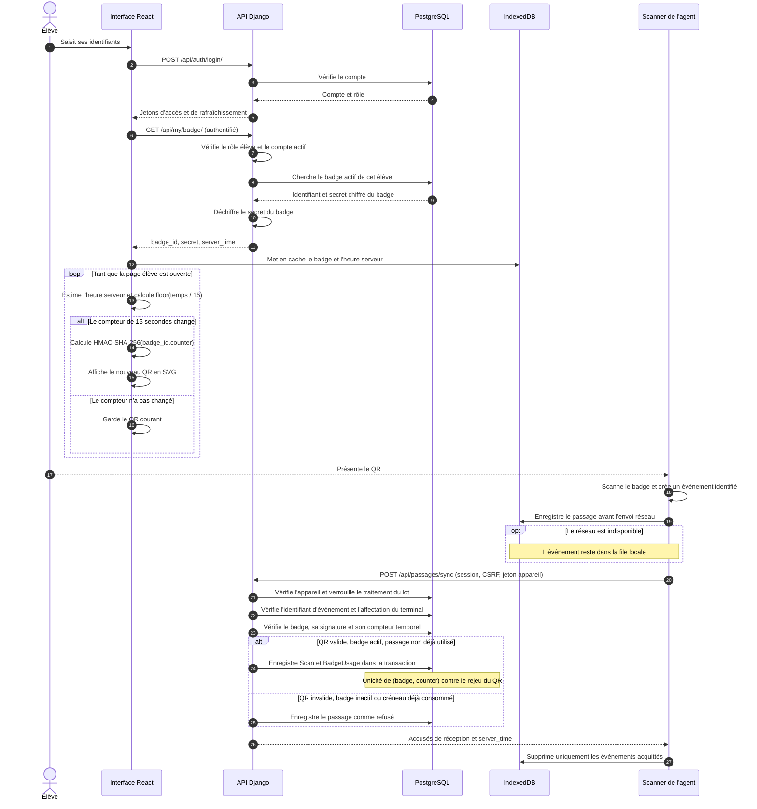

# Afric’Éduc — SchoolLogs Passage

Application de suivi des passages par QR tournant, avec API Django, interface React et file locale IndexedDB. L’appareil de portail ne choisit ni élève, ni point de contrôle, ni direction : le serveur les déduit du badge et de l’affectation authentifiée du terminal.

## Stack

- Django, Django REST Framework et PostgreSQL.
- React et Vite.
- IndexedDB, `jsQR` et Service Worker natif pour le mode hors ligne.
- APScheduler dans un conteneur séparé pour clôturer les fenêtres.
- Aucun broker ni worker de file externe.

## Configuration et démarrage

Copier le modèle puis renseigner les secrets et mots de passe locaux dans `.env` :

```powershell
Copy-Item .env.example .env
[Convert]::ToBase64String([Security.Cryptography.RandomNumberGenerator]::GetBytes(48))
[Convert]::ToBase64String([Security.Cryptography.RandomNumberGenerator]::GetBytes(32)).TrimEnd('=').Replace('+','-').Replace('/','_')
```

La première commande génère une clé Django; la seconde une clé URL-safe de 32 octets pour chiffrer les secrets de badge. Définir aussi un mot de passe PostgreSQL et les quatre mots de passe `DEMO_*_PASSWORD`. Ne jamais copier ces valeurs dans le dépôt. `.env` est ignoré par Git.

Lancer les conteneurs :

```powershell
docker compose up --build
```

L’interface est sur http://localhost:5173 et l’API sur http://localhost:8000/api. Le conteneur backend applique les migrations et configure le lecteur QR PostgreSQL; le conteneur `scheduler` clôture les fenêtres avec le délai `PASSAGE_GRACE_MINUTES`. Les données de démonstration ne sont pas créées automatiquement.

Pour lancer le frontend sans Docker : `Set-Location frontend; npm ci; npm run dev`. Pour le backend seul, renseigner `POSTGRES_HOST=localhost`, puis lancer `python manage.py migrate`, `python manage.py seed_demo` et `python manage.py runserver` dans `backend`.

## Enrôlement et usage du portail

1. Connectez-vous comme responsable sur le navigateur du terminal.
2. Créez ou sélectionnez le point de contrôle puis choisissez **Enrôler le terminal pour ce portail**. Le secret d’appareil est conservé dans IndexedDB et n’est affiché qu’une fois par la réponse d’enrôlement.
3. Déconnectez-vous, connectez-vous comme agent sur le même navigateur et ouvrez l’écran de scan.
4. L’agent scanne le badge; le passage est écrit dans IndexedDB avant tout envoi. À la reconnexion, les événements acquittés sont supprimés localement.

**Avant le premier usage hors ligne, ouvrir l’application une fois en ligne** afin de mettre en cache la coquille de l’écran de scan. La caméra, le Service Worker et `crypto.randomUUID()` exigent **HTTPS ou localhost**. Une calibration serveur est requise avant le premier scan; chaque réponse serveur recale ensuite l’horloge monotone. Le QR de l’élève utilise aussi l’heure serveur et son badge déjà chargé reste disponible hors ligne.

Le navigateur affiche uniquement l’état réseau, le nombre d’événements en attente et les retours du scan en cours. Les refus tardifs de la synchronisation ne sont pas affichés à l’agent. La mise à jour du Service Worker est contrôlée par le bouton **Mettre à jour**.

## QR personnel de l’élève

Après connexion, chaque élève authentifié récupère uniquement son propre badge actif via `GET /api/my/badge/`. Le secret du badge est conservé chiffré en base; le navigateur reçoit le secret nécessaire au calcul du QR et le met en cache dans IndexedDB pour l’affichage hors ligne. L’heure renvoyée par l’API sert à estimer l’heure serveur, même si l’horloge locale dérive.

Le QR est généré dans le navigateur et dessiné en SVG par le composant local `QrSvg` (sans bibliothèque QR externe). Son contenu est `badge_id.counter.signature`; la signature est un HMAC-SHA-256 tronqué à 16 octets. Le compteur change toutes les **15 secondes**, ce qui renouvelle le code présenté par l’élève.



Le scanner conserve ses événements dans IndexedDB sans réseau, puis les envoie au retour de la connexion. Le serveur déduplique les renvois avec `(device_id, event_id)` et interdit de consommer deux fois le même QR avec `(badge, counter)`. Le point de contrôle et la direction du passage sont déterminés côté serveur.

À la réception, le backend recalcule la signature, vérifie que le badge et l’élève sont actifs et contrôle la fenêtre temporelle du compteur. Les quatre tests ciblés couvrent la falsification de signature, un compteur hors fenêtre, un badge inactif, le rejeu d’un QR et l’accès aux identifiants par le compte élève concerné. La GitHub Action lance ces tests et vérifie l’état des migrations.

## API principale

- `POST /api/auth/login/` et `POST /api/auth/session/` : authentification JWT et session protégée par CSRF.
- `POST /api/devices/` : enrôlement d’un terminal par un responsable; `POST /api/devices/{uuid}/assign/` enregistre une réaffectation datée.
- `POST /api/devices/time-sync/` : calibration de l’horloge du terminal enrôlé.
- `GET /api/my/badge/` : identifiants QR du badge actif de l’élève connecté uniquement.
- `POST /api/passages/sync` : lot transactionnel d’au plus 100 événements, accessible à un agent authentifié par session/CSRF et secret d’appareil.
- `GET /api/students/`, `GET /api/scans/`, `GET /api/anomalies/` et `GET /api/outbox/` : ressources filtrées selon le rôle.
- `GET /api/anomalies/non-treated-count/` : compteur des anomalies ouvertes ou provisoires pour le responsable.
- `POST /api/anomalies/close-windows/` : clôture manuelle; en production, le scheduler l’exécute périodiquement.

La synchronisation répond avec `{acks, server_time}`. Chaque accusé identifie l’événement et son résultat générique; aucune identité d’élève ni motif de refus n’est renvoyé par cette route. Les clés uniques `(device_id, event_id)` et `(badge, counter)` protègent respectivement contre le renvoi technique et le rejeu du QR.

## Commandes de gestion

```powershell
python manage.py migrate
python manage.py seed_demo
python manage.py run_scheduler
python manage.py rebuild_journal 2026-11-25
```

`seed_demo` est idempotente et requiert les mots de passe de démonstration définis dans l’environnement. `rebuild_journal` reconstruit le journal local depuis les passages acceptés.

## Vérifications

```powershell
pytest
python manage.py makemigrations passage --check --dry-run --noinput
Set-Location frontend; npm run build
```

La GitHub Action démarre PostgreSQL, vérifie les migrations, lance les tests backend et construit le frontend. Les tests prioritaires de synchronisation contrôlent les renvois répétés, les lots partiels, les accusés initiaux, le rollback atomique, l’autorité du terminal, les rôles, l’horloge et les écritures concurrentes.
